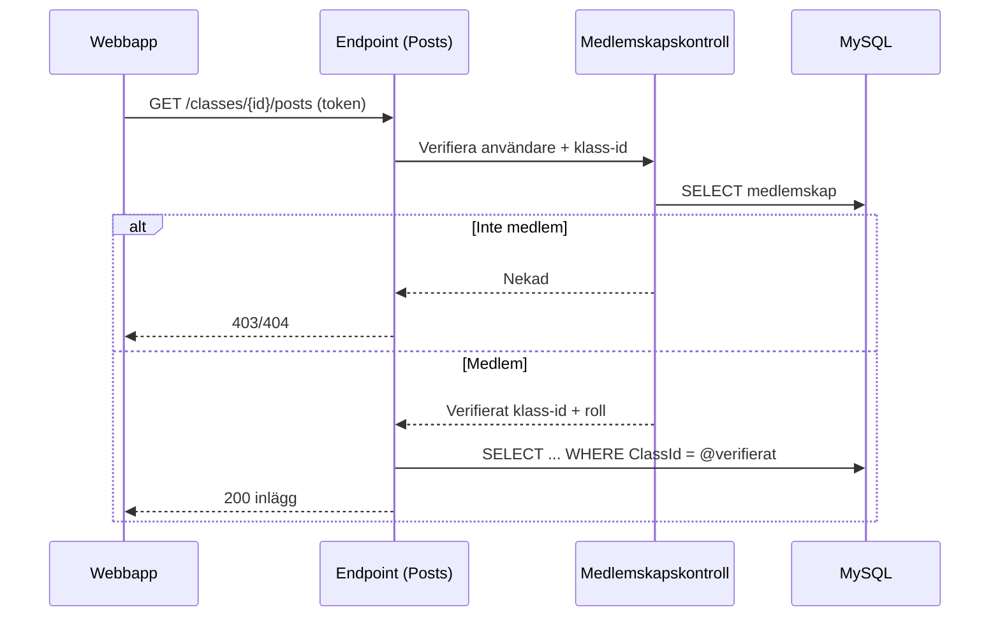

# Prompt-historik – 2026-11-26 (session e0b06d56)

Export av en Claude Code-session: utvecklarens prompter och AI:ns svar (verktygsanrop och systemkontext är utelämnade). Genereras automatiskt av `scripts/export-prompt-history.py`. Länkar i svaren speglar filstrukturen vid tillfället och kan vara inaktuella.

## 1. Prompt

> Explore, Discuss: Kan du läsa igenom repots material och återkoppla din förståelse till mig.

### Svar

Jag har läst allt. Repot är litet: en commit och fem filer. Det finns ingen kod ännu, bara riktlinjer och tidiga specifikationer.

#### Vad som finns

**[Claude.md](../Claude.md)** beskriver hur vi ska samarbeta: arbetslägen (DISCUSS, EXPLORE, SPECIFY osv.), att specifikation, dokumentation, kod och tester ska hållas i paritet, och att du fattar besluten.

**[Application-description.md](Application-description.md)** beskriver Klass-social, en social plattform för en skolklass med elever och lärare. Syftet är kortare kommunikationsvägar, bättre sammanhållning, mindre isolering och mer samarbete mellan elever. Arbetet ska ske iterativt utifrån en prioriterad funktionslista, och allt behöver inte byggas från början.

**[Functionalty.md](Functionalty.md)** listar tio funktionsområden:
- användare och roller
- material
- kommunikation
- grupper
- kalender
- rumsbokning
- närvaro
- AI
- notiser
- tillägg

Där finns också övergripande krav på tillgänglighet, integritet och social miljö.

**[Technology.md](Technology.md)** och **[UseCases.md](UseCases.md)** är tomma mallar. Det tolkar jag som att nästa steg är att formulera use cases och välja teknik.

#### Min tolkning
Funktionslistan är en bred önskelista, inte en kravspecifikation. Den saknar prioritering, avgränsning och beteendebeskrivningar. Ungefär hälften av punkterna, till exempel videosamtal, närvaro, AI, GitHub-synk och tillägg, beskrivs själva som "på sikt". En rimlig första version är troligen konton och roller, en klass, anslagstavla, textkanaler och privat chatt, grupper och en gemensam kalender. Det är mitt antagande och inget beslut.

#### Saker jag la märke till
- **Namnen skiljer sig åt.** Repot heter "Klassologi" men dokumenten säger "Klass-social".
- **Stavfel i filnamnet:** "Functionalty.md" ska vara "Functionality.md".
- **Filnamnet Claude.md:** git har filen som `Claude.md`, men den laddas som `CLAUDE.md`. Det fungerar bara för att macOS inte skiljer på stora och små bokstäver i filnamn. På Linux och i CI kan det sluta fungera.

#### Öppna frågor som påverkar arkitektur och säkerhet
1. **Anonyma frågor:** ska de vara anonyma för alla, även lärare och administratörer, eller bara för andra elever? Det påverkar både hur data lagras och möjligheten att moderera, till exempel vid kränkningar. Det kolliderar också med kravet på "god ton".
2. **Vem är användaren?** Om eleverna är minderåriga styr det GDPR, samtycke och inloggningsmetod, till exempel skolans SSO.
3. **Omfattning:** är det en klass, flera klasser eller hela skolor? Det avgör datamodellen, alltså om man behöver flera separata organisationer i samma system.
4. **Närvarokontroll:** att kontrollera att eleven är på skolan kräver plats- eller nätverksdata. Det är integritetskänsligt och bör utredas för sig.
5. **Roller:** vad får en elevrepresentant göra som en vanlig elev inte får? Vem skapar klasser och tilldelar roller?
6. **Externa parter:** kanalerna för företag och lärosäten innebär att externa användare kommer in i systemet. Det är en egen behörighetsfråga.
7. **Webb och mobil:** påverkar teknikvalet tidigt, till exempel en responsiv webbapp, en PWA eller en separat mobilapp.

Ett naturligt nästa steg är att i SPECIFY-läge prioritera funktionerna och skriva use cases för första versionen, eller att först reda ut frågorna ovan. Vad vill du börja med?

## 2. Prompt

> Fixa paritet enligt dina kommentarer "Saker jag la märke till"

### Svar

Jag har åtgärdat två av de tre punkterna. Den tredje kräver ett beslut från dig.

**Ändrat** (förberett i git men inte committat):
- `Specifications/Functionalty.md` heter nu [Functionality.md](Specifications/Functionality.md).
- `Claude.md` heter nu [CLAUDE.md](CLAUDE.md). Git registrerar nu den nya stavningen, så filen hittas även där stora och små bokstäver skiljs åt, till exempel på Linux och i CI.
- [UseCases.md](Specifications/UseCases.md) pekade på det gamla filnamnet. Den hänvisningen är rättad och är nu klickbara länkar till båda dokumenten.

**Kontrollerat:** jag sökte igenom repot och hittade inga fler hänvisningar till de gamla filnamnen. Ändringarna går att se med `git status`.

**Inte åtgärdat: namnet.** Repot heter "Klassologi" medan dokumenten säger "Klass-social". Vilket namn som gäller är ditt beslut, så jag har inte ändrat det. Välj ett av alternativen:
1. Produkten heter Klass-social. Då behåller vi Klassologi som namn på repot och skriver det i dokumentationen.
2. Produkten heter Klassologi. Då byter jag namnet i dokumenten.
3. Något annat.

Säg till om du vill att jag committar.

## 3. Prompt

> Ja, commita

### Svar

Klart. Ändringarna är committade som `b2a5e5b` på `main` och arbetskatalogen är ren. Inget är pushat.

Frågan om namnet, "Klassologi" eller "Klass-social", är fortfarande öppen.

## 4. Prompt

> pusha

### Svar

Pushat. Commit `b2a5e5b` ligger nu på `main` i `origin` (github.com/WeeHorse/Klassologi).

Du har fortfarande inte valt namn, "Klassologi" eller "Klass-social".

## 5. Prompt

> Klassologi

### Svar

Jag har bytt namnet till Klassologi i specifikationerna. "Klass-social" förekom på tre ställen:
- rubriken och första meningen i [Application-description.md](Specifications/Application-description.md)
- rubriken i [Functionality.md](Specifications/Functionality.md)

En sökning i repot efteråt hittar inga fler förekomster av det gamla namnet, så namnfrågan är löst. Ändringen är varken committad eller pushad. Ska jag göra båda?

## 6. Prompt

> Japp

### Svar

Namnbytet är committat som `c210580` och pushat till `origin/main`, och arbetskatalogen är ren. De tre punkterna jag tog upp om filnamn och namn är nu åtgärdade.

## 7. Prompt

> Kan du samla frågorna i ett dokument, Questions.md i spec?

### Svar

Skrivet för dig och teamet som specificerar Klassologi.

Jag har skapat [Questions.md](Specifications/Questions.md) med de öppna frågorna, numrerade Q1–Q8. Varje fråga har en status, de delar av specifikationen den gäller och en kort förklaring av varför den behöver besvaras.

Utöver de sju frågorna från min genomgång har jag lagt till Q8 om vad första versionen ska innehålla. Mitt förslag på innehåll står där som ett förslag och inte som ett beslut. Överst i filen finns också en rad om hur besvarade frågor ska hanteras: beslutet förs över till rätt specifikation och frågan markeras som besvarad.

Filen är varken committad eller pushad.

## 8. Prompt

> Spara prompt-historiken i repot. Var hittar jag den sen?

### Svar

Svarens egna rubriker krockar med prompt-rubrikerna, så jag justerar formatet.

Jag har sparat historiken som [PromptHistory/2026-11-26.md](PromptHistory/2026-11-26.md) i repots rotkatalog. Filen innehåller dina åtta prompter med mina svar, numrerade i ordning. Verktygsanrop och systemkontext har jag tagit bort, och jag har kontrollerat att filen inte innehåller din e-postadress. Mitt svar på den här sista prompten finns inte med, eftersom det inte var skrivet när jag exporterade.

**Var du hittar historiken senare:**
- **I repot:** `PromptHistory/`, med en fil per datum.
- **Originalet:** Claude Code sparar varje session i `~/.claude/projects/-Volumes-Files-OneDrive-Projects-Klassologi/`, i dag som filen `e0b06d56-….jsonl`. Den filen är rådata med verktygsanrop och systemkontext, och den ligger utanför repot och synkas inte. Committa den inte rakt av.
- **Fortsätta en session:** använd `/resume` i Claude Code.

**Att tänka på:**
- Exporten är en ögonblicksbild. Vill du ha senare prompter med får vi exportera igen. Skriptet ligger tillfälligt i `/private/tmp/claude-501/-Volumes-Files-OneDrive-Projects-Klassologi/e0b06d56-0176-4752-bbae-4b03d791caed/scratchpad/export.py` och kan försvinna. Vill du göra det här regelbundet kan jag lägga skriptet i repot.
- Länkarna i de gamla svaren pekar på filer som de hette då, till exempel `Functionalty.md`, så en del fungerar inte längre. Det står en notering om det överst i filen.

Varken `PromptHistory/` eller `Specifications/Questions.md` är committade. Ska jag committa och pusha dem?

## 9. Prompt

> Upprätthåll prompthistoriken under allt cå

### Svar

Det är samma uppdrag, så jag fortsätter. Nu testar jag skriptet så som hooken kommer att köra det.

Exporten fungerar. Texten som skillen laddade in kom inte med, vilket är rätt. Nu tar jag bort den gamla manuella exportfilen, som den nya ersätter, och lägger till hooken.

Skrivet för dig och andra som arbetar med Claude Code i repot.

Prompthistoriken uppdateras nu automatiskt efter varje svar jag ger.

**Så fungerar det:**
- [scripts/export-prompt-history.py](scripts/export-prompt-history.py) läser sessionens transkript och skriver en fil per session till `PromptHistory/<datum>-<session-id>.md`. Dagens fil är [PromptHistory/2026-11-26-e0b06d56.md](PromptHistory/2026-11-26-e0b06d56.md). Den gamla manuella exporten har jag tagit bort, eftersom den nya filen ersätter den.
- [.claude/settings.json](.claude/settings.json) innehåller en Stop-hook, alltså ett kommando som Claude Code kör varje gång jag har svarat klart. Hooken kör skriptet. Inställningen gäller hela projektet och följer med i git.
- Filen innehåller bara dina prompter och mina svar. Verktygsanrop, systemkontext, IDE-notiser och skill-texter tas bort. Varje gång skriptet körs skrivs filen om i sin helhet från transkriptet.

**Verifierat:**
- Jag körde skriptet med samma indata som hooken får, och det skapade rätt fil med rätt rubriker.
- Filen innehåller inte din e-postadress.
- Inställningsfilen är giltig JSON.

**Inte verifierat:** att hooken faktiskt körs i en riktig session. Mappen `.claude/` fanns inte när sessionen startade, och därför läser Claude Code troligen inte in den nya inställningen förrän du öppnar `/hooks` en gång eller startar om sessionen. Efter det kan du kontrollera att filen i `PromptHistory/` uppdateras efter ett svar.

**Begränsningar:**
- Hooken skriver bara filen. Den committar inget, så historiken kommer med när vi committar annat.
- Hooken körs bara i Claude Code i det här repot. Om ni är flera som använder Claude Code här skrivs även era sessioner till `PromptHistory/`.
- Skriptet kräver Python 3.10 eller senare. Du har 3.12.
- Hooken sväljer fel så att den aldrig blockerar arbetet. Om skriptet slutar fungera märks det alltså bara på att filen inte uppdateras.

Inget är committat än. Ska jag committa och pusha `.claude/`, `scripts/`, `PromptHistory/` och `Specifications/Questions.md`?

## 10. Prompt

> Ja, committa

### Svar

Jag har committat de fyra nya filerna som `683ab10` på `main`. Precis innan körde jag exporten en gång till, så prompthistoriken i commiten är uppdaterad till och med din förra prompt. Arbetskatalogen var ren efter commiten.

Inget är pushat.

Efter varje svar uppdaterar hooken historikfilen, så `PromptHistory/2026-11-26-e0b06d56.md` kommer att visas som ändrad igen. Det är väntat. Ändringarna följer med nästa gång vi committar.

## 11. Prompt

> och pusha

### Svar

Commit `683ab10` är nu pushad till `origin/main`.

Historikfilen `PromptHistory/2026-11-26-e0b06d56.md` har ändrats igen efter commiten, och den ändringen är inte pushad. Det tyder på att hooken redan körs, men det är en slutsats och inget jag har kontrollerat. Ändringen följer med nästa gång vi committar.

## 12. Prompt

> Be mig besvara frågorna i Questions (eller andra frågor) när ett beslut behövs för arbetet vi gör.

### Svar

Jag har sparat det här som en arbetsregel i mitt minne för projektet, så den gäller även i kommande sessioner:

- När arbetet kräver ett beslut som finns i [Questions.md](Specifications/Questions.md), eller en ny fråga som inte är besvarad, frågar jag dig just då. Jag hänvisar till frågans id, till exempel Q3, beskriver avvägningen kort och ger en rekommendation.
- Frågor som arbetet inte behöver just då frågar jag inte om.
- När du har svarat för jag in beslutet i rätt specifikation och markerar frågan som **Besvarad** i Questions.md.
- Nya frågor som dyker upp men inte behövs än lägger jag till i Questions.md som **Öppen**.

Minnet finns bara lokalt hos dig. Om andra i teamet också arbetar med Claude kan jag lägga in regeln i [CLAUDE.md](CLAUDE.md) så att den gäller för alla. Vill du det?

## 13. Prompt

> Ja, lägg in det i CLAUDE.md

### Svar

Regeln står nu i CLAUDE.md, så minnesposten behövs inte längre. Jag tar bort den för att undvika dubbletter.

Regeln finns nu i [CLAUDE.md](CLAUDE.md) under avsnittet **Open questions** i Interaction-delen. Den gäller alla som arbetar med Claude i repot. Jag skrev den på engelska som resten av filen, men statusorden **Öppen** och **Besvarad** är kvar på svenska eftersom Questions.md använder dem.

Jag har också tagit bort min lokala minnespost om samma sak, så att regeln bara finns på ett ställe.

Varken CLAUDE.md eller den uppdaterade prompthistoriken är committade. Ska jag committa och pusha?

## 14. Prompt

> Kan du ta fram en bruttolista med use cases baserat på functionalty och prioritera dem efter core-application mvp principer. T ex platform -> användare -> poster

### Svar

Skrivet för dig och teamet som specificerar Klassologi.

Bruttolistan finns i [UseCases.md](Specifications/UseCases.md). Den innehåller 43 use cases, UC-01 till UC-43, sorterade i lager efter vad varje lager behöver från lagret före:

| Lager | Innehåll | Use cases |
|-------|----------|-----------|
| 1. Plattform | skapa klass, bjuda in användare, tilldela roller | UC-01–03 |
| 2. Användare | registrering, inloggning, profil, klasslista | UC-04–07 |
| 3. Poster | publicera, läsa, redigera, kommentera och moderera på anslagstavlan | UC-08–12 |
| 4–8 | kommunikation, grupper, material, kalender, notiser | UC-13–30 |
| Senare | ej inbördes ordnade: video, rumsbokning, närvaro, AI, tillägg m.m. | UC-31–43 |

**Föreslagen MVP: lager 1–3.** Det ger en klass där man loggar in och där information publiceras och läses på ett ställe. Det är den minsta helhet som uppfyller kärnsyftet, att samla klassens information. Det här är ett förslag och inget beslut.

Varje use case anger aktör, mål, vilka andra use cases det beror på och vilka öppna frågor som påverkar det. Aktörerna är preliminära tills rollerna i Q5 är bestämda.

**Ändringar i [Questions.md](Specifications/Questions.md):**
- Förslaget i Q8 pekar nu på bruttolistan. Mitt tidigare förslag tog med chatt, grupper och kalender i MVP, och det stämde inte längre.
- **Q9 är ny:** vad betyder "kategorisering av elever"? Formuleringen är otydlig och kan röra känsliga personuppgifter.
- **Q10 är ny:** vem får publicera och kommentera på anslagstavlan? Den frågan påverkar MVP direkt.

Inga frågor behöver besvaras för själva bruttolistan. När vi börjar detaljera MVP:ns use cases kommer jag att behöva svar på:
- **Q2:** inloggning och användarnas ålder
- **Q3:** en klass, flera klasser eller flera skolor
- **Q5:** roller och behörigheter
- **Q10:** vem som får publicera och kommentera

Ingenting är committat.

## 15. Prompt

> Committa och pusha

### Svar

Ändringarna är committade som `7d90539` och pushade till `origin/main`. Arbetskatalogen var ren direkt efteråt.

Commiten innehåller:
- bruttolistan med use cases i [UseCases.md](Specifications/UseCases.md)
- de nya frågorna Q9 och Q10 och det uppdaterade förslaget i Q8 i [Questions.md](Specifications/Questions.md)
- regeln om att fråga när ett beslut behövs i [CLAUDE.md](CLAUDE.md)
- prompthistoriken, som jag uppdaterade precis före commiten

## 16. Prompt

> Ok, teknologier: Helt oberoende av min erfarenhet av teknologier, vad skulle du välja för att skapa lösningen?

### Svar

Det här är min rekommendation. Inget är beslutat, och några val hänger på öppna frågor.

#### Mitt val

**TypeScript genom hela stacken**, i ett monorepo med pnpm workspaces. Klient och server delar typer och valideringsscheman (Zod), så API-kontraktet blir en enda sanning som både kod och tester kan kontrolleras mot.

| Del | Val | Varför |
|-----|-----|--------|
| Klient | **Expo (React Native) med Expo Router** | En kodbas för iOS, Android och webb. Ger riktiga push-notiser och snabbåtgärder från låsskärmen, vilket en PWA (webbapp som installeras som app) inte klarar fullt ut. |
| Backend | **Modulär monolit i Node: Fastify + Drizzle ORM** | Enkel att förstå, testa och driftsätta. Modulerna följer funktionsområdena, till exempel klass, användare, anslagstavla och kommunikation, och kan delas upp senare om det behövs. |
| Databas | **PostgreSQL** | Datat är relationellt: klasser, medlemskap, roller, inlägg. Postgres räcker långt, även för sökning (full-text) och enklare realtidshändelser. |
| Autentisering | **Etablerat bibliotek med stöd för OIDC/SAML**, t.ex. Better Auth eller Keycloak | Inget eget autentiseringssystem. Valet beror på Q2: om skolans inloggning via Skolfederation (SAML) krävs blir Keycloak mer aktuellt. |
| Behörighet | **Egen, explicit behörighetskontroll i backend** | Rollerna, anonymiteten (Q1) och klassavgränsningen är kärnan i säkerheten. Därför vill jag ha den som läsbar och enhetstestbar kod. |
| Realtid | **WebSockets**, senare Redis pub/sub vid flera servrar | Behövs först i lager 4 (chatt). Inte i MVP. |
| Filer | **S3-kompatibel objektlagring** | Standard, billig, och finns hos EU-leverantörer. |
| Video/röst | **LiveKit** (öppen källkod, WebRTC) | Det är orimligt att bygga detta själv. Ligger under "senare". |
| Push | **Expo Notifications** (APNs/FCM) | Följer med klientvalet. |
| Drift | **EU-baserad hosting**, t.ex. Hetzner, Scaleway eller AWS Stockholm | Användarna är troligen minderåriga och GDPR gäller. |
| Test | **Vitest** (enhet/integration), **Testcontainers** (riktig Postgres i tester), **Playwright** (webb end-to-end) | Testar mot verkligt beteende i stället för mockar. |

#### Det främsta alternativet: Supabase
Supabase bygger också på Postgres och ger inloggning, realtid, fillagring och behörighet på radnivå (RLS) direkt. Det skulle göra MVP:n betydligt snabbare att bygga.

Jag väljer det ändå inte, eftersom behörighetslogiken då hamnar i SQL-policies. De är svårare att läsa, testa och resonera om, och här är behörigheten den mest kritiska delen. Om utvecklingstakt väger tyngre än kontroll är Supabase ett rimligt val.

#### Avvägningar att känna till
- **Expo på webben** blir funktionellt men något mindre "webbigt" än till exempel Next.js. Om webben visar sig vara den viktigaste kanalen kan vi lägga till en separat Next.js-klient som delar logik med appen. Det är mer kod att underhålla.
- **En egen backend** betyder mer att bygga från början än med Supabase, i gengäld för full kontroll.

#### Kopplingar till öppna frågor
- **Q7, webb och mobil:** mitt förslag förutsätter en riktig mobilapp, i praktiken "båda från start via Expo". Om det räcker med webb i början blir Next.js + PWA enklare.
- **Q2, inloggning:** avgör vilken autentiseringslösning som passar.
- **Q3, omfattning:** jag skulle ändå bygga datamodellen så att varje klass eller organisation hålls isär från början. Det kostar lite nu och mycket att lägga till i efterhand.

Vill du att jag skriver in det här i [Technology.md](Specifications/Technology.md) som ett förslag, eller vill du diskutera något av valen först?

## 17. Prompt

> Ska vi jämföra med ett imperativt, clear architecture, minimal API C# .NET alternativt för backend?

### Svar

Ja. Jag tolkar "clear architecture" som *Clean Architecture*. Säg till om du menar något annat.

#### Jämförelse av backend

| Aspekt | TypeScript (Fastify + Drizzle) | C# .NET (Minimal API + Clean Architecture) |
|--------|-------------------------------|-------------------------------------------|
| **Typsäkerhet** | God, men TypeScript kontrollerar inte typerna när programmet körs, så Zod behövs vid systemgränserna | Starkare. Typerna gäller även när programmet körs, och kompilatorn fångar mer |
| **Kontrakt mot klienten** | Klient och server delar typer direkt | Kontraktet genereras från OpenAPI till TypeScript-klient, t.ex. med NSwag, Kiota eller orval. Ett extra steg, men kontraktet blir explicit och versionerbart |
| **Inloggning och behörighet** | Bibliotek från tredje part, t.ex. Better Auth | ASP.NET Core har inbyggda policies för behörighet och mogna OIDC-lösningar (OpenIddict, Microsoft.Identity.Web). SAML för Skolfederation finns via bibliotek |
| **Realtid (chatt)** | WebSockets eller Socket.IO, och Redis när flera servrar behövs | **SignalR** passar mycket bra: grupper som motsvarar klasser och kanaler, automatisk återanslutning och färdig skalning via Redis |
| **Dataåtkomst** | Drizzle, nära SQL | EF Core, moget, med migreringar och LINQ |
| **Test** | Vitest, Testcontainers | xUnit, Testcontainers, `WebApplicationFactory` (riktiga HTTP-anrop mot API:t i minnet) |
| **Prestanda** | Tillräcklig | Bättre, men det avgör knappast för den här appen |
| **Antal språk** | Ett | Två (C# och TypeScript) |
| **Ekosystemets stabilitet** | Rörligt, med många små beroenden | Stabilt, med det mesta från Microsoft och stöd för långtidsversioner (LTS) |

#### Clean Architecture: en reservation
Clean Architecture med lagren Domain, Application, Infrastructure och API ger tydliga gränser och en domän som går att testa. Men den blir lätt ceremoniell för en app där mycket är skapa, läsa, uppdatera och ta bort data, som anslagstavlan i MVP:n.

Om vi väljer den rekommenderar jag en lätt variant:
- **Organisera per funktion inom lagren**, till exempel `Classes/`, `Posts/`, `Messaging/`, i stället för tekniska mappar som `Services/` och `Repositories/`.
- **Inget generiskt repository ovanpå EF Core.** DbContext är redan ett sådant lager.
- **Inget MediatR eller liknande indirektion** som standard. Imperativa handlers som anropas direkt från minimal API-endpoints är lättare att följa och debugga. Det stämmer också med ditt "imperativt".
- **Ett rikare domänlager där reglerna faktiskt finns:** roller, anonymitet, moderering och klassavgränsning.

#### Min bedömning
För just backend är .NET-alternativet **minst likvärdigt och på flera punkter bättre**. SignalR, de inbyggda behörighetspolicyerna och den stabilare plattformen väger tyngre än att klient och server delar typer. Den uppdelningen hanteras bra med ett genererat OpenAPI-kontrakt.

Det som talar emot är främst att det blir två språk, och lite mer struktur från början om Clean Architecture tillämpas för strikt.

Jag skulle därför välja **.NET (minimal API, lätt Clean Architecture, EF Core, PostgreSQL, SignalR)** för backend, behålla **Expo** för klienten och låta OpenAPI vara kontraktet mellan dem.

Vill du att jag dokumenterar det i [Technology.md](Specifications/Technology.md) som förslag, eller ska vi diskutera vidare först, till exempel lagerindelningen?

## 18. Prompt

> Om jag också skulle välja MySQL, tappar vi bort viktiga aspekter på autentiseringen eller kan vi mitigera det?

### Svar

Kort svar: **nej, autentiseringen förlorar inget väsentligt på MySQL.** De skillnader som finns går att hantera.

#### Varför autentiseringen inte påverkas
Autentiseringen bor i applikationen eller i en identitetstjänst, inte i databasen. ASP.NET Core Identity, OpenIddict och Keycloak fungerar alla med MySQL. Databasen lagrar bara användare, lösenordshashar, tokens och sessioner, och det klarar båda databaserna lika bra.

#### Skillnader som berör säkerheten, och hur de hanteras

| Område | Risk med MySQL | Åtgärd |
|--------|----------------|--------|
| **Radnivåskydd (RLS)** | MySQL saknar RLS. Databasen kan alltså inte själv stoppa att data läcker mellan klasser. | Vi förlitade oss ändå inte på RLS, eftersom behörigheten ligger i .NET. Lägg till **globala query-filter i EF Core** för klassavgränsningen och tester som verifierar att data inte läcker mellan klasser. Vi tappar ett extra skyddslager, inte själva skyddet. |
| **Sortering och jämförelse av text (collation)** | Standardinställningen i MySQL 8 skiljer inte på stora och små bokstäver eller på accenter. Då kan "Åsa" och "Asa" räknas som samma användarnamn. | Identity jämför redan normaliserade fält (`NormalizedEmail`, `NormalizedUserName`). Sätt dessutom en uttrycklig collation på identitetskolumnerna. |
| **Teckenkodning** | `utf8` i MySQL är en begränsad variant som tappar till exempel emoji. | Använd alltid `utf8mb4`. |
| **Tyst avkortning av data** | Om strikt läge är avstängt kan för långa värden, som tokens, kapas utan felmeddelande. | Kontrollera att `STRICT_TRANS_TABLES` är på. Det är standard i MySQL 8. |
| **Tidsstämplar** | Typen `TIMESTAMP` slutar fungera år 2038 och påverkas av tidszonsinställningar. Det rör bland annat när tokens går ut. | Använd `DATETIME(6)` och lagra alltid tid i UTC. |

#### Det som faktiskt skiljer, utanför autentiseringen
- **Databasdrivrutinen för EF Core:** Pomelo, den bästa MySQL-drivrutinen, underhålls av communityn och har ibland släpat efter nya EF Core-versioner. Npgsql för Postgres har legat närmare EF Core. Det är en risk för underhållet, inte för säkerheten.
- **Migreringar:** MySQL kan inte rulla tillbaka schemaändringar inom en transaktion. En migrering som misslyckas halvvägs kan därför lämna databasen i ett halvfärdigt läge. Det motverkas med små migreringar och backup före driftsättning.
- **Fulltextsökning och JSON:** Postgres är något starkare. Det spelar mindre roll i MVP:n.

#### Bedömning
Med åtgärderna ovan är MySQL ett fullt fungerande val. Postgres har fortfarande en liten fördel genom RLS som extra skydd, transaktionella migreringar och en drivrutin som ligger närmare EF Core. Ingen av fördelarna är avgörande.

Om det finns ett skäl till MySQL, till exempel erfarenhet, befintlig drift eller hosting, väger det tyngre än de här skillnaderna.

## 19. Prompt

> Jag vill att vi väljer MySQL och .Net som besrkivet, men det är viktigt med en tunn, imperativ arkitektur med minimun av ceremoni.

### Svar

Skrivet för dig och teamet som bygger Klassologi.

Jag har dokumenterat beslutet i [Technology.md](Specifications/Technology.md). Där är varje val markerat som **Beslutat**, **Förslag** eller **Att verifiera**.

**Beslutat:**
- .NET med ASP.NET Core Minimal API, MySQL 8 och EF Core.
- En tunn, imperativ arkitektur:
  - koden organiseras per funktionsområde
  - endpoints anropar vanliga metoder som använder `DbContext` direkt
  - ingen mediator, inga generiska repositories, inga interfaces som bara har en implementation och inga separata lagerprojekt förrän ett konkret behov finns
- Säkerhetsåtgärderna för MySQL från vår diskussion, till exempel `utf8mb4`, uttrycklig collation, strikt läge, UTC-tid och query-filter som håller isär klasserna.

Clean Architecture med separata lager har jag alltså tolkat bort till förmån för din betoning på minimal ceremoni. Det som finns kvar av den är att affärsreglerna samlas och går att testa. Säg till om du menade något annat.

**Förslag:** SignalR, Expo som klient (beror på Q7), autentiseringslösning (beror på Q2), OpenAPI som kontrakt mot klienten, och den preliminära mappstrukturen.

**Att verifiera:** att Pomelo, MySQL-drivrutinen för EF Core, stöder den EF Core-version vi väljer. Den har tidigare släpat efter nya versioner. Det bör kontrolleras innan vi börjar bygga.

Ingenting är committat.

## 20. Prompt

> Bekräfta Pomelo

### Svar

Alla tre paketen finns i aktuella versioner, och MySqlConnector 3.0.0 har byggnader för `net10.0` och `net11.0`. Nu uppdaterar jag Technology.md.

Pomelo är kontrollerat, och data­åtkomsten är nu bestämd: Dapper med MySqlConnector, utan EF Core. Jag har uppdaterat [Technology.md](Specifications/Technology.md) efter ditt val.

**Pomelo:** senaste versionen är 9.0.0, och den fungerar bara med EF Core 9. Det fanns ingen version för EF Core 10 på NuGet. Det har jag kontrollerat direkt. Att supporten för .NET och EF Core 9 har upphört bygger på vad jag vet om Microsofts supportcykel, inte på en kontroll i dag.

**Paketen är kontrollerade på NuGet:**
- Dapper 2.1.100
- MySqlConnector 3.0.0, med byggnad för `net10.0`
- dbup-mysql 6.1.0

**Konsekvenser som nu står i Technology.md:**
- **Klassavgränsningen sker i koden.** Den kan inte längre lösas med query-filter i EF Core. Varje fråga mot data som hör till en klass tar klassens id som parameter. Id:t hämtas från användarens verifierade medlemskap, aldrig enbart från det som klienten skickar. Kontrollen ligger på ett ställe, och tester ska visa att data inte läcker mellan klasser. Det här är den viktigaste säkerhetsfrågan med valet.
- **Migreringar görs med versionerade SQL-skript**, till exempel med DbUp. Det står som förslag.
- **Autentiseringen påverkas.** ASP.NET Core Identity kan inte längre använda sin färdiga lagring, som bygger på EF Core. Valet står mellan en extern identitetstjänst, som Keycloak, och Identity med egen lagring via Dapper. Det hänger ihop med Q2 och avgörs när vi kommer dit.

Technology.md ändrades på disk efter mina redigeringar. Jag har inte läst om den, så jag har inte sett den ändringen och den finns inte med i sammanfattningen ovan.

Ingenting är committat.

## 21. Prompt

> Committa och pusha

### Svar

Technology.md ändrades på disk efter mina redigeringar, så jag läser igenom den innan jag committar.

Filen innehåller det jag skrev, inklusive min egen ändring av en formulering med `sed`. Det var den ändringen som syntes. Inget främmande har kommit in.

Jag har läst igenom Technology.md innan commiten. Ändringen på disk var min egen omformulering av en mening, så inget annat hade kommit in.

Commiten heter `cc2338b` och är pushad till `origin/main`. Arbetskatalogen var ren efteråt. Den innehåller [Technology.md](Specifications/Technology.md) med teknikvalen och prompthistoriken, som jag uppdaterade precis före commiten.

## 22. Prompt

> Hur tänkte du om frontend? Native TS eller något ramverk?

### Svar

Hittills har jag föreslagit **Expo (React Native)**, alltså ett ramverk. Med dina val för backend, en tunn och imperativ arkitektur med minimal ceremoni, är jag inte längre säker på att det passar. Här är hur jag ser alternativen.

#### Tre vägar

| | Expo / React Native | Webb först + Capacitor | Ren TS som PWA |
|---|---|---|---|
| **Kärna** | React med native-komponenter | Vanlig webbapp i TS, inslagen i ett native-skal för iOS och Android | Vanlig webbapp i TS, installerbar i webbläsaren (PWA) |
| **Ceremoni** | Hög: Reacts tankemodell, Metro-bygget, EAS-byggtjänst | Låg för webbkoden, plus ett tunt native-skal | Lägst |
| **Mobil: push** | Fullt stöd | Fullt stöd via plugin | Fungerar, men begränsat på iOS |
| **Snabbåtgärder från låsskärmen** | Ja | Ja via plugin (*bör verifieras i detalj*) | I praktiken nej på iOS |
| **Webbupplevelse** | Fungerar, men är inte riktigt "webbig" | Riktig webb | Riktig webb |
| **Passar din arkitekturfilosofi** | Dåligt | Bra | Bäst |

#### Ren TS eller ramverk
Ren TS fungerar utmärkt för MVP:n, där anslagstavlan i stort sett bara är sidor med listor och formulär. Två risker växer med appen:

1. **Säkerhet:** appen visar text som användarna själva skrivit, i inlägg, kommentarer och chatt. Med ren DOM-kod räcker det med ett `innerHTML` på fel ställe för att öppna för XSS, alltså att någon kan köra skript i andra användares webbläsare. Ramverk skyddar mot det automatiskt.
2. **Ett hemsnickrat ramverk:** när realtidschatt, notiser och många vyer kommer till i lager 4 och framåt brukar man börja bygga egna mekanismer för tillstånd och omritning. Det blir till slut ett eget, odokumenterat ramverk.

#### Min rekommendation
**TypeScript + Vite + lit-html, webb först, och Capacitor när mobilen behövs.**

- **lit-html** är bara ett mallbibliotek, inget ramverk. Det renderar HTML med automatisk escaping av text, vilket löser XSS-risken. Resten av koden kan vara vanlig imperativ TS med egna moduler, `fetch` mot API:t och ingen ramverksmagi.
- Vi förbjuder `innerHTML` med en lint-regel.
- Klienten mot API:t genereras från OpenAPI, som tidigare föreslagits.
- **Capacitor** läggs till först när appen ska ut i appbutikerna. Webbkoden ändras inte.
- **Stoppunkt:** om vi märker att vi bygger eget tillstånds- och renderingsmaskineri, troligen kring chatten i lager 4, utvärderar vi ett lätt ramverk som Svelte eller Preact.

Det här ändrar mitt tidigare förslag om Expo och hänger ihop med **Q7**. Om låsskärmsåtgärder behövs tidigt talar det fortfarande lite för Expo. Om webben räcker i början är min rekommendation tydligt bättre.

Vill du att jag uppdaterar [Technology.md](Specifications/Technology.md) med det här som förslag, eller vill du besluta direkt?

## 23. Prompt

> Vad är Capacitor?

### Svar

Capacitor är ett verktyg från Ionic som gör en vanlig webbapp till en riktig app för iOS och Android.

**Så fungerar det:**
- Webbappen (HTML, CSS, TS) byggs som vanligt och läggs in i ett native-skal: ett riktigt Xcode-projekt för iOS och ett Android Studio-projekt för Android.
- Skalet visar webbappen i en inbyggd webbvy (WebView) i helskärm. För användaren ser det ut och installeras som en vanlig app från App Store eller Google Play.
- **Plugins** ger webbkoden tillgång till telefonens funktioner via ett vanligt TS-anrop. Exempel är push-notiser, kamera, filer och biometrisk inloggning. Det finns färdiga plugins för det vanligaste, och man kan skriva egna i Swift eller Kotlin när något saknas.

**Varför jag föreslog det:**
- Det är ingen ramverk för gränssnittet. Det spelar ingen roll om webbappen är skriven i ren TS, lit-html, React eller något annat.
- Vi kan bygga webben först och lägga till Capacitor när appen ska ut i appbutikerna, utan att skriva om något.
- Det ger det som en PWA inte klarar fullt ut på iOS: pålitliga push-notiser och notiser med åtgärder.

**Begränsningar:**
- Gränssnittet är fortfarande webb. Det känns sällan exakt som en native-app, särskilt vid tunga animationer eller långa listor. Det spelar mindre roll för en app som Klassologi.
- Man behöver fortfarande Xcode (och därmed en Mac) för att bygga till iOS, samt utvecklarkonton för båda appbutikerna.
- Vissa saker kräver lite native-kod eller plugins från tredje part. Snabbsvar direkt från låsskärmen är en sådan sak som bör verifieras innan vi lovar den.

**Jämfört med Expo:** Expo ritar gränssnittet med riktiga native-komponenter. Det ger en mer native känsla, men koden måste skrivas i React Native. Capacitor låter oss behålla en vanlig webbapp.

## 24. Prompt

> Bra, vi kör på detta

### Svar

Beslutet är dokumenterat.

**[Technology.md](Specifications/Technology.md):**
- **Klienten** byggs med TypeScript, Vite och lit-html, och webben kommer först. Mobilappen blir ett Capacitor-skal kring webbappen. Båda står som **Beslutat**.
- Ett nytt avsnitt, **Frontend**, beskriver principerna:
  - vanlig imperativ TS organiserad per funktion
  - lit-html används bara för att rendera HTML
  - en lint-regel förbjuder `innerHTML`
  - webben ska fungera fullt ut utan mobilskalet
- Avsnittet anger också när vi ska utvärdera ett lätt ramverk, nämligen om vi börjar bygga egen hantering av tillstånd och omritning, troligen kring chatten i lager 4. Det beskriver även varför Expo valdes bort.
- Testraden har fått Vitest och Playwright för frontend. Den är fortfarande ett förslag.
- Under **Att verifiera** står nu att snabbsvar från notiser och låsskärm ska kontrolleras i Capacitor innan vi kommer till lager 8, notiserna.

**[Questions.md](Specifications/Questions.md):** Jag har markerat **Q7 som Besvarad**: webb först, mobilapp via Capacitor senare. Den tolkningen drog jag själv av ditt "vi kör på detta", eftersom rekommendationen innehöll just den ordningen. Säg till om du inte menade att avgöra Q7 med det.

Ingenting är committat.

## 25. Prompt

> Vi kör på Vitest + Playwright. Jag föreslår XUnit för backendtest, samt Newman (Postman CLI) för API-tester. Vad tycker du?

### Svar

Jag håller med om xUnit. Newman tycker jag också är ett bra val, om vi ger det en tydlig roll som inte överlappar med xUnit.

**En precisering:** Newman och "Postman CLI" är två olika verktyg. Newman har öppen källkod, körs via npm och kräver inget Postman-konto. Senaste versionen är 6.2.3 från oktober 2026, så det underhålls. Postman CLI är Postmans nyare, stängda verktyg och kräver inloggning. Jag förutsätter att du menar Newman.

#### Hur jag skulle fördela testerna

| Verktyg | Vad det testar | Typiskt innehåll |
|---------|----------------|------------------|
| **xUnit** (enhetstester) | Affärsregler isolerat | Roller, behörighetsregler, anonymitet, validering |
| **xUnit + `WebApplicationFactory` + Testcontainers** | API:t inifrån, mot en riktig MySQL | Klassavgränsning, behörighet per endpoint, felfall, databasbeteende. Här kan testerna själva lägga in testdata och skapa flera användare och klasser. |
| **Newman** | API:t utifrån som en svart låda, mot en körande miljö | Use-case-flöden från början till slut och kontraktet mot frontend. Även snabba kontroller efter driftsättning. |
| **Vitest** | Frontendlogik | |
| **Playwright** | Hela flöden i webbläsaren | Kritiska flöden i MVP:n |

#### Vad Newman tillför
- **Oberoende verifiering**, något som CLAUDE.md betonar. Postman-samlingar kan skrivas utifrån use cases och API-kontraktet utan att man tittar på implementationen.
- **Samma samling används både för utforskande och automatiserade tester.** Man utforskar API:t i Postman och kör sedan samma samling automatiskt i CI.
- **Kan köras mot vilken miljö som helst**, till exempel lokalt, i staging eller i produktion.

#### Risker och hur de hanteras
- **Dubbelarbete.** Kontroller av behörighet och klassavgränsning hör hemma i xUnit-integrationstesterna, där testdata går att styra. Newman testar flöden och kontrakt.
- **Samlingarna är stora JSON-filer** som är svåra att granska i git. Vi kan exportera dem till repot, hålla dem små och dela upp dem per use case eller lager.
- **Hemligheter.** Tokens och lösenord får inte ligga i samlingar eller miljöfiler i repot. De ska läsas från miljövariabler. Undvik också att synka miljöer med hemligheter till Postmans moln.
- **Tillstånd mellan körningar.** Newman-tester behöver en känd utgångspunkt. Vi kan använda en återställbar testmiljö eller låta varje körning skapa sin egen klass.

Om git-vänlighet blir ett problem finns textbaserade alternativ som Bruno eller `.http`-filer. Jag föreslår att vi börjar med Newman och utvärderar om det skaver.

Ska jag dokumentera det så här i [Technology.md](Specifications/Technology.md), med Vitest och Playwright som beslutade och xUnit och Newman fördelade enligt tabellen?

## 26. Prompt

> Ja tack, vi kör på detta.

### Svar

Jag har dokumenterat testvalen i [Technology.md](Specifications/Technology.md).

- **Översiktstabellen:** testraden är nu **Beslutat**, med xUnit för backend, Newman för API och Vitest och Playwright för frontend.
- **Nytt avsnitt, Test:**
  - Ansvarsfördelningen mellan verktygen, med samma tabell som vi diskuterade.
  - Riktlinjerna: ingen dubblering av tester, Newman-samlingar skrivs utifrån use cases och inte utifrån koden, Newman och inte Postman CLI, samlingarna versioneras i repot, inga hemligheter i repot, varje körning startar från känd testdata, och textbaserade alternativ utvärderas om samlingarna blir svåra att granska.

Även frontendbeslutet och Q7 från förra rundan väntar på commit. Ska jag committa och pusha allt?

## 27. Prompt

> Jag vill att vi lägger till Jacob Nielsens UX Heuristiker som krav också.

### Svar

Skrivet för dig och teamet som specificerar Klassologi.

Jag har lagt in heuristikerna som krav i [Functionality.md](Specifications/Functionality.md), i ett nytt avsnitt **Användbarhet** under Övergripande krav.

- **Alla tio heuristiker finns med**, var och en med en kort förklaring och ett exempel från Klassologi. Ett exempel är att gränssnittet tydligt ska visa om en fråga ställs anonymt eller inte. Den regeln faller under "förebygga fel".
- **Verifiering:** heuristikerna är kvalitativa och går inte att kontrollera fullt ut med automatiska tester. Jag har därför skrivit att de ska verifieras genom en heuristisk utvärdering av gränssnittet, åtminstone innan ett lager i use case-listan räknas som klart. Den utvärderingen kan jag göra, men någon i teamet behöver också göra den manuellt.

Namnet stavas *Jakob* Nielsen, och det är så det står i dokumentet.

Tre saker väntar fortfarande på commit: frontendbeslutet med Q7, testbesluten och användbarhetskraven. Ska jag committa och pusha?

## 28. Prompt

> Committa och pusha

### Svar

Allt är committat som `9e0793f` och pushat till `origin/main`. Arbetskatalogen var ren efteråt.

Commiten innehåller:
- **Frontend och test:** valen i [Technology.md](Specifications/Technology.md).
- **Q7:** markerad som besvarad i [Questions.md](Specifications/Questions.md).
- **Användbarhet:** heuristikerna som krav i [Functionality.md](Specifications/Functionality.md).
- **Prompthistoriken:** uppdaterad precis före commiten.

## 29. Prompt

> Från och med nu vill jag att vi använder feature-branches per feature och godkänner via PR. Vi kör testerna lokalt tills vidare, flyttar till pipeline senare.

### Svar

Skrivet för dig och andra som arbetar i repot, människor och AI.

Arbetsflödet står nu i [CLAUDE.md](CLAUDE.md) under ett nytt avsnitt, **Version control and review**:

- Varje feature utvecklas på en egen branch som heter `feature/<kort-namn>` och skapas från en uppdaterad `main`.
- Ändringar når `main` bara via en PR. Du granskar, godkänner och mergar. Jag mergar aldrig.
- Ändringar i specifikationer som hör till en feature följer med i featurens PR. Fristående ändringar i dokumentationen får gå direkt till `main`.
- Testerna körs lokalt innan en PR öppnas eller uppdateras. PR-beskrivningen ska ange vilka tester som kördes och vad resultatet blev.

Jag har också lagt till i [Technology.md](Specifications/Technology.md) att testerna körs lokalt tills vidare och flyttas till en CI-pipeline senare.

Det här var fristående ändringar i dokumentationen. Enligt den nya regeln får de committas direkt till `main`.

Ett förslag, som jag inte har gjort: aktivera branch protection på `main` i GitHub, så att PR-kravet gäller tekniskt och inte bara enligt överenskommelse.

Ingenting är committat. Ska jag committa och pusha till `main`?

## 30. Prompt

> Committa och pusha

### Svar

Ändringarna är committade som `affb79f` och pushade till `origin/main`. Arbetskatalogen var ren direkt efteråt.

Det var fristående ändringar i dokumentationen, så de gick direkt till `main` enligt den nya regeln. Commiten innehåller arbetsflödet i [CLAUDE.md](CLAUDE.md), noteringen om lokala tester i [Technology.md](Specifications/Technology.md) och den uppdaterade prompthistoriken.

Från och med nu skapar jag en `feature/`-branch för varje feature, och du granskar och mergar via PR.

## 31. Prompt

> Kan du illustrera hur systemarkitekturen kommer att se ut? Kanske UML? Mermaid? Eller vad tycker du?

### Svar

## 32. Prompt

> This session is being continued from a previous conversation that ran out of context. The summary below covers the earlier portion of the conversation.
> 
> <system-reminder>
> <tools-used-before-summary>AskUserQuestion, Bash, Edit, Read, Skill, Write</tools-used-before-summary>
> </system-reminder>
> Summary:
> 1. Primary Request and Intent:
>    The user works in Swedish. The project is Klassologi, a social app for school classes. The repo is /Volumes/Files/OneDrive/Projects/Klassologi with remote https://github.com/WeeHorse/Klassologi.git on branch main. The project's CLAUDE.md defines collaborative working modes (DISCUSS, EXPLORE, SPECIFY, DESIGN, IMPLEMENT, TEST, PARITY, REVIEW, SYNC, DELEGATE), parity between specs, docs, code and tests, and that the human decides.
> 
>    Requests in order:
>    - Explore the repo and report my understanding.
>    - Fix the parity issues I found:
>      - file name typo
>      - CLAUDE.md casing
>      - product name mismatch (resolved as Klassologi)
>    - Commit and push.
>    - Collect the open questions in Specifications/Questions.md.
>    - Save the prompt history in the repo, then maintain it automatically.
>    - When a decision is needed, ask the open questions just-in-time. This rule was put into CLAUDE.md.
>    - Create a gross list of use cases prioritized by MVP layers (platform → users → posts).
>    - Discuss technology. Decisions:
>      - backend: .NET Minimal API with a thin, imperative, minimal-ceremony architecture
>      - database: MySQL
>      - data access: Dapper + MySqlConnector, after Pomelo turned out not to support EF Core 10
>      - frontend: TypeScript + Vite + lit-html, web first, Capacitor later
>      - tests: xUnit, Newman, Vitest and Playwright
>    - Add Jakob Nielsen's 10 usability heuristics as requirements.
>    - Latest: from now on use feature branches per feature with approval via PR. Tests run locally for now and move to a pipeline later.
> 
> 2. Key Technical Concepts:
>    - Claude Code Stop hook in .claude/settings.json that runs the Python export script. It reads `transcript_path` from stdin, and `CLAUDE_PROJECT_DIR` is used.
>    - Backend:
>      - ASP.NET Core Minimal API organized per feature (Features/Classes, Users, Posts)
>      - endpoints call plain methods directly
>      - no mediator, no generic repositories, no single-implementation interfaces, no layer projects
>    - Data:
>      - Dapper + MySqlConnector 3.0.0 (net10.0)
>      - versioned SQL migrations (DbUp proposal)
>      - no EF Core, so no global query filters; class isolation is enforced in code: the class id comes from verified membership, the check is centralized, and tests verify it
>    - MySQL mitigations:
>      - utf8mb4
>      - explicit collation and normalized fields
>      - STRICT_TRANS_TABLES
>      - DATETIME(6) in UTC
>      - small migrations with backup (no transactional DDL)
>    - Proposals:
>      - SignalR for realtime
>      - OpenAPI-generated TypeScript client
>      - auth via an OIDC-capable established solution (Identity with Dapper storage, or Keycloak; depends on Q2)
>      - S3-compatible storage, LiveKit, EU hosting
>    - Frontend:
>      - lit-html for safe escaping
>      - lint rule banning innerHTML
>      - Capacitor native shell later
>      - stop point: evaluate Svelte or Preact if a homemade framework starts to grow (around chat, layer 4)
>    - Test split:
>      - xUnit for unit tests and for WebApplicationFactory + Testcontainers integration tests (authorization and class isolation)
>      - Newman as black-box tests from use cases (no secrets in repo, collections in repo)
>      - Vitest
>      - Playwright
>    - NuGet checks on 2026-11-26:
>      - Pomelo latest 9.0.0, locked to EF Core 9.x, published 2025-08
>      - Oracle MySql.EntityFrameworkCore 10.0.12
>      - Dapper 2.1.100
>      - dbup-mysql 6.1.0
>      - Newman 6.2.3 (2026-10)
> 
> 3. Files and Code Sections:
>    - **CLAUDE.md** (renamed from Claude.md). Added "### Open questions" under Interaction:
>      - unresolved questions live in Specifications/Questions.md
>      - ask at the point the work needs a decision, referencing the question id, with trade-off and recommendation
>      - don't ask about questions the work doesn't need
>      - after a decision, record it in the spec and mark **Besvarad** in Questions.md
>      - add new questions as **Öppen**
> 
>      Added "## Version control and review" before "## Continuous quality assurance":
>      ```
>      - Develop each feature on its own branch, created from an up-to-date `main` and named `feature/<short-name>`.
>      - Feature changes reach `main` only through a pull request. The developer reviews, approves and merges. The AI never merges.
>      - Specification and documentation changes that belong to a feature are included in that feature's branch and pull request.
>      - Standalone specification and documentation changes, not tied to a feature, may be committed directly to `main`.
>      - Tests run locally until a CI pipeline is in place. Before opening or updating a pull request, run the relevant tests locally and state in the pull request description which tests were run and their results. Do not claim tests passed unless they were actually run.
>      ```
>    - **Specifications/Application-description.md**: "Klass-social" replaced by "Klassologi".
>    - **Specifications/Functionality.md**:
>      - renamed from Functionalty.md
>      - "Klass-social" replaced by "Klassologi"
>      - added "## Användbarhet" with Nielsen's 10 heuristics, each with a Klassologi example
>      - verification by heuristic evaluation at least before each use case layer is considered done
>    - **Specifications/Questions.md**:
>      - Q1 anonymity
>      - Q2 age/login/SSO
>      - Q3 scope one class/many/schools
>      - Q4 attendance location
>      - Q5 roles
>      - Q6 external parties
>      - Q7 web/mobile: **Besvarad**, web first, Capacitor later
>      - Q8 MVP scope: proposal is layers 1–3 of the use case list
>      - Q9 what "kategorisering av elever" means
>      - Q10 who may publish and comment on the notice board
>    - **Specifications/UseCases.md**: gross list UC-01–UC-43 in tables (ID, use case, actor, goal, depends on, questions).
>      - Layer 1 Platform: UC-01–03
>      - Layer 2 Users: UC-04–07
>      - Layer 3 Posts/notice board: UC-08–12
>      - MVP line after layer 3
>      - Layers 4–8: Communication, Groups, Material, Calendar, Notifications (UC-13–30)
>      - "Senare": UC-31–43
>    - **Specifications/Technology.md**:
>      - overview table with statuses Beslutat/Förslag/Att verifiera
>      - sections: Arkitektur (with proposed src/ structure), Frontend, Dataåtkomst: Dapper utan EF Core, Test (responsibility table + guidelines + "Körs lokalt tills vidare"), Databas: MySQL – säkerhetsåtgärder
>      - Att verifiera: Capacitor notification and lockscreen actions; SAML support
>    - **scripts/export-prompt-history.py**:
>      - exports user prompts and assistant text to `PromptHistory/<date>-<session8>.md`
>      - skips sidechain/meta entries and texts starting with `<ide_`, `<system-reminder`, `<command-`, `<local-command`
>      - demotes reply headings by 2 levels
>    - **.claude/settings.json**:
>      ```json
>      {"hooks":{"Stop":[{"hooks":[{"type":"command","command":"python3 -I \"$CLAUDE_PROJECT_DIR/scripts/export-prompt-history.py\" 2>/dev/null || true","timeout":30}]}]}}
>      ```
>    - **PromptHistory/2026-11-26-e0b06d56.md**: auto-generated history. I refresh it manually before each commit with:
>      ```
>      echo '{"transcript_path":"~/.claude/projects/-Volumes-Files-OneDrive-Projects-Klassologi/e0b06d56-0176-4752-bbae-4b03d791caed.jsonl"}' | CLAUDE_PROJECT_DIR="$PWD" python3 -I scripts/export-prompt-history.py
>      ```
>    - Commits on main: b2a5e5b, c210580, 683ab10, 7d90539, cc2338b, 9e0793f, affb79f (latest: "Add feature-branch and pull request workflow"). All pushed.
> 
> 4. Errors and fixes:
>    - zsh glob error with `--include=*.md`: I reran grep with `--exclude-dir=.git`.
>    - Assistant-reply headings collided with prompt headings in the export: I numbered the prompts, added "### Svar", and demoted reply headings.
>    - The Pomelo incompatibility was discovered by checking NuGet. The user chose "Dapper utan EF Core".
>    - A "file changed on disk" notice for Technology.md: I reviewed the file before committing. It was my own sed edit (hen → "som användaren inte tillhör").
>    - A duplicate memory entry existed after the open-questions rule moved to CLAUDE.md, so I deleted the memory file and its MEMORY.md line. The memory index is now empty.
> 
> 5. Problem Solving:
>    - Parity issues are resolved.
>    - The prompt history hook is verified by a pipe-test only. Live firing was not confirmed: `.claude/` didn't exist at session start, so the user may need to open `/hooks` or restart. A modified history file after a commit suggests it is working.
>    - I suggested, but did not do, enabling GitHub branch protection on main.
> 
> 6. All user messages:
>    - "Explore, Discuss: Kan du läsa igenom repots material och återkoppla din förståelse till mig."
>    - "Fixa paritet enligt dina kommentarer "Saker jag la märke till""
>    - "Ja, commita"
>    - "pusha"
>    - "Klassologi"
>    - "Japp"
>    - "Kan du samla frågorna i ett dokument, Questions.md i spec?"
>    - "Spara prompt-historiken i repot. Var hittar jag den sen?"
>    - "Upprätthåll prompthistoriken under allt cå" / "Upprätthåll prompthistoriken under allt vårt arbete"
>    - "Ja, committa"
>    - "och pusha"
>    - "Be mig besvara frågorna i Questions (eller andra frågor) när ett beslut behövs för arbetet vi gör."
>    - "Ja, lägg in det i CLAUDE.md"
>    - "Kan du ta fram en bruttolista med use cases baserat på functionalty och prioritera dem efter core-application mvp principer. T ex platform -> användare -> poster"
>    - "Committa och pusha"
>    - "Ok, teknologier: Helt oberoende av min erfarenhet av teknologier, vad skulle du välja för att skapa lösningen?"
>    - "Ska vi jämföra med ett imperativt, clear architecture, minimal API C# .NET alternativt för backend?"
>    - "Om jag också skulle välja MySQL, tappar vi bort viktiga aspekter på autentiseringen eller kan vi mitigera det?"
>    - "Jag vill att vi väljer MySQL och .Net som besrkivet, men det är viktigt med en tunn, imperativ arkitektur med minimun av ceremoni."
>    - "Bekräfta Pomelo" (then the AskUserQuestion answer: "Dapper utan EF Core")
>    - "Committa och pusha"
>    - "Hur tänkte du om frontend? Native TS eller något ramverk?"
>    - "Vad är Capacitor?"
>    - "Bra, vi kör på detta"
>    - "Vi kör på Vitest + Playwright. Jag föreslår XUnit för backendtest, samt Newman (Postman CLI) för API-tester. Vad tycker du?"
>    - "Ja tack, vi kör på detta."
>    - "Jag vill att vi lägger till Jacob Nielsens UX Heuristiker som krav också."
>    - "Committa och pusha"
>    - "Från och med nu vill jag att vi använder feature-branches per feature och godkänner via PR. Vi kör testerna lokalt tills vidare, flyttar till pipeline senare." (AskUserQuestion answer: "Spec med feature")
>    - "Committa och pusha"
> 
>    Standing constraints:
>    - Commit and push only when the user asks.
>    - The AI never merges PRs.
>    - Feature work goes on `feature/<short-name>` branches via PR. Standalone doc changes may go directly to main.
>    - No secrets in the repo; Newman tokens come from environment variables.
>    - Don't share the user's email.
>    - Don't commit raw transcript JSONL.
> 
> 7. Pending Tasks:
>    - None explicitly pending.
>    - Optional offers not yet taken up: enable branch protection on GitHub; detail the MVP use cases (this will need Q2, Q3, Q5 and Q10 answered just-in-time).
> 
> 8. Current Work:
>    The user said "Committa och pusha" for the workflow docs. I ran the history export, committed CLAUDE.md, Specifications/Technology.md and PromptHistory/ on main as `affb79f` ("Add feature-branch and pull request workflow"), and pushed (9e0793f..affb79f main -> main). The working tree was clean afterwards. The confirmation message to the user had not been written yet.
> 
> 9. Optional Next Step:
>    Tell the user, briefly and in Swedish, that commit `affb79f` is pushed to origin/main and that the working tree is clean. Don't start new work. Future feature work should follow the new rule: "Develop each feature on its own branch, created from an up-to-date `main` and named `feature/<short-name>`... The developer reviews, approves and merges. The AI never merges."
> 
> If you need specific details from before compaction (like exact code snippets, error messages, or content you generated), read the full transcript at: /Users/b/.claude/projects/-Volumes-Files-OneDrive-Projects-Klassologi/e0b06d56-0176-4752-bbae-4b03d791caed.jsonl
> Continue the conversation from where it left off without asking the user any further questions. Resume directly — do not acknowledge the summary, do not recap what was happening, do not preface with "I'll continue" or similar. Pick up the last task as if the break never happened.
> 
> The messages after this summary are the most recent messages from before compaction, kept verbatim. The summary was written without seeing them, so something it says has not happened yet may already have happened in them.

### Svar

Jag föreslår **Mermaid i Markdown**, ritat enligt **C4-modellens nivåer**. Fullständig UML skulle jag inte använda.

**Varför:**
- **Mermaid** är text och ligger i repot bredvid specarna. Det syns i git-diffar, granskas i PR:er och renderas direkt på GitHub och i VS Code. Det gör det lättare att hålla diagrammen i takt med specar och kod.
- **C4** visar systemet på några få zoomnivåer: kontext, containrar och komponenter. Det passar en tunn arkitektur bättre än UML:s klass- och paketdiagram, som snabbt blir ceremoni.
- **UML-sekvensdiagram** (också i Mermaid) använder jag bara för flöden där ordningen spelar roll, till exempel behörighetskontrollen.

Jag ritar C4 med Mermaids `flowchart`, inte med dess `C4`-syntax. C4-syntaxen är fortfarande experimentell och renderas sämre.

Här är ett utkast. Allt som bara är ett förslag är markerat, inget är skrivet till fil.

**Containernivå**


**Sekvens: klassbunden förfrågan** (visar regeln om klassavgränsning)



Ett beslut som behövs senare: om en icke-medlem ska få 403 eller 404 (404 avslöjar inte att klassen finns). Det hör hemma i detaljeringen av UC-09, inte nu.

**Var diagrammen ska ligga:** Jag föreslår en egen `Specifications/Architecture.md` med kontext- och containerdiagrammet plus sekvensdiagram för nyckelflöden. Technology.md fortsätter att beskriva *val och motiveringar*, och Architecture.md visar *strukturen*. Komponentnivån väntar tills koden finns, annars ritar vi gissningar.

Vill du att jag skapar filen och lägger in diagrammen? Det är en fristående dokumentändring, så den kan gå direkt till `main`.

## 33. Prompt

> Ja tack

### Svar

Enligt regeln om öppna frågor lägger jag också in frågan om 403/404 som en öppen fråga.

Jag har skapat [Architecture.md](Specifications/Architecture.md). Den innehåller tre diagram i Mermaid:
- **Kontext:** användarna (preliminära roller) och identitetslösningen.
- **Containrar:** webbapp, Capacitor-skal, API, SignalR, MySQL, identitetslösning och objektlagring, plus en tabell med ansvar och status för varje del.
- **Klassbunden förfrågan:** ett sekvensdiagram som visar hur klassavgränsningen fungerar utan query-filter.

Två andra filer är också ändrade:
- [Technology.md](Specifications/Technology.md) länkar till diagrammen från avsnittet Arkitektur.
- [Questions.md](Specifications/Questions.md) har en ny öppen fråga, **Q11**: ska en icke-medlem få 403 eller 404? Frågan behöver besvaras först när UC-09 detaljeras.

Jag har inte kontrollerat att diagrammen ritas upp. Det syns enklast i VS Codes Markdown-förhandsvisning eller på GitHub efter push.

Ändringarna är inte committade. Säg till när du vill att de ska upp på `main`.

## 34. Prompt

> Jag tror att VS Codes preview inte riktigt ritar diagrammen, kan du kolla.

### Svar

Jag kunde inte kontrollera det fullt ut. Jag tänkte rendera diagrammen med Mermaids eget CLI (`npx @mermaid-js/mermaid-cli`), men det nekades av behörighetsklassificeraren eftersom kommandot laddar ner ett npm-paket med webbläsare. Jag har inte försökt ta mig runt det.

**Det jag kunde kontrollera:**
- Tillägget **Markdown Preview Mermaid Support** (`bierner.markdown-mermaid` 1.32.1) är installerat. Utan det ritar VS Codes inbyggda förhandsvisning inte Mermaid alls, utan visar bara koden.
- Jag har gått igenom syntaxen i de tre diagrammen manuellt och hittar inget fel. Nodformerna, de streckade pilarna med text, `<br/>` i citerad text och `alt`/`else` i sekvensdiagrammet är alla giltig Mermaid. Det är inte samma sak som att ha sett dem renderas.

**Vad ser du i förhandsvisningen?**
- **Råkod i grå block:** tillägget är troligen inte laddat i fönstret. Kör *Developer: Reload Window* och öppna förhandsvisningen igen med `⇧⌘V`.
- **Felmeddelande i stället för ett diagram:** då är det syntaxen. Klistra in felet så rättar jag diagrammet.
- **Tomt eller halvt ritat:** kan bero på temat eller på storleken. Säg vilket diagram det gäller.

Om du vill att jag verifierar automatiskt kan du tillåta mermaid-cli. Det körs via `npx` i scratchpaden och rör inte repot.

## 35. Prompt

> Tomt eller halvritat

### Svar

Jag har ändrat de två flödesdiagrammen (Kontext och Containrar) i [Architecture.md](Specifications/Architecture.md). Det jag gjorde bygger på en hypotes som inte är verifierad, eftersom jag inte kan se din förhandsvisning:

- Båda diagrammen ritar nu texten som SVG-text i stället för HTML. Det gör jag med en rad `%%{init: {"htmlLabels": false, ...}}%%` överst i varje diagram. Jag tror att texten klipptes för att förhandsvisningen mätte den innan typsnittet hade laddats, och SVG-text brukar mätas rätt.
- Kanttexten med radbrytning är förkortad till `HTTPS/JSON`. Uppgiften att API-klienten genereras från OpenAPI står fortfarande i [Technology.md](Specifications/Technology.md), men den syns inte längre i diagrammet.
- Sekvensdiagrammet har jag inte ändrat, eftersom inställningen inte påverkar den typen av diagram.

Öppna förhandsvisningen igen. Om något fortfarande ser trasigt ut, säg vilket av de tre diagrammen det gäller och hur det ser ut, eller tillåt mermaid-cli så kan jag rendera dem och se själv.

## 36. Prompt

> Nu ritas de, committa och pusha

### Svar

Ändringarna är committade som `7baa9ce` och pushade direkt till `main`. Det var fristående dokumentation, så de gick inte via en feature-branch.

Commiten innehåller:
- den nya [Architecture.md](Specifications/Architecture.md) med diagrammen
- länken från [Technology.md](Specifications/Technology.md) till diagrammen
- den nya öppna frågan Q11 i [Questions.md](Specifications/Questions.md)
- den uppdaterade prompthistoriken

I arbetskatalogen ligger nu en okänd `.DS_Store`-fil som macOS har skapat. Jag har inte lagt till den i commiten. Vill du att jag lägger in den i en `.gitignore`?

## 37. Prompt

> Ja, lägg till .gitignore och committa

### Svar

Jag har skapat en ny `.gitignore` som gör att git ignorerar `.DS_Store` och committat den på `main` som `8f5b1cb`. Det finns inga ändringar kvar att committa.

Den uppdaterade prompthistoriken följde med i samma commit.

Commiten är inte pushad, eftersom du bara bad om commit. Säg till om jag ska pusha.

## 38. Prompt

> Kan du lägga in allt i gitignore som vi typiskt behöver i TS och .NEt utvecklingen?

### Svar

Jag har fyllt på [.gitignore](.gitignore) med det vi typiskt behöver. Ändringen är varken committad eller pushad.

| Område | Vad som ignoreras |
|---|---|
| OS | macOS- och Windows-skräpfiler, t.ex. `.DS_Store` |
| Editorer | `.vs/`, `.idea/`, `*.user`. `.vscode/` ignoreras utom de delade filerna `settings`, `extensions`, `launch` och `tasks`. |
| Claude Code | `.claude/settings.local.json`. Projektets `.claude/settings.json` med hooken för prompthistoriken följer fortfarande med. |
| Hemligheter | `.env*` (utom `.env.example`), lokala `appsettings.*.local.json`, certifikat- och nyckelfiler. Det stöder regeln om inga hemligheter i repot. |
| .NET | `bin/`, `obj/`, NuGet-paket, `TestResults/`, täckningsfiler |
| Node/TS/Vite | `node_modules/`, `dist/`, `.vite/`, `*.tsbuildinfo`, loggar |
| Test | Rapporter och täckning från Vitest, Playwright och Newman |
| Capacitor | Byggkataloger för Android och iOS, inför att mobilskalen läggs till |

Jag har kört `git ls-files -ci --exclude-standard`, och ingen fil som redan finns i repot blir ignorerad.

Det mesta är förberett för kod och verktyg som ännu inte finns, så mönstren kan behöva justeras när projekten skapas. Ett exempel är om vi lägger konfigurationen för lokal utveckling i User Secrets eller i `appsettings.*.local.json`.

Varningarna i editorn för `.gitignore` kommer bara från stavningskontrollen och är inga fel.

## 39. Prompt

> commit and push

### Svar

Den utökade `.gitignore` och den uppdaterade prompthistoriken är committade som `e604e80` och pushade till `origin/main`. Även den tidigare commiten `8f5b1cb`, som bara ignorerade `.DS_Store`, följde med i pushen. Det finns inga ändringar kvar att committa.

## 40. Prompt

> Jag tänker först köra databasen helt lokalt, genom Docker.

### Svar

Det låter som en bra start. Det stämmer med att testerna körs lokalt tills vidare, och det kräver inga beslut om hosting ännu.

**Så här skulle jag sätta upp det:**
- **`docker-compose.yml` i repot** med en MySQL-tjänst. Den startas med `docker compose up -d`. Datat sparas i en namngiven volym, så det finns kvar mellan omstarter, och `docker compose down -v` ger en ren databas.
- **Säkerhetsinställningarna från Technology.md sätts redan här:** `utf8mb4` med uttrycklig collation, `STRICT_TRANS_TABLES` och tidszon UTC. Då beter sig den lokala databasen som den riktiga ska göra.
- **Lösenord i `.env`**, som redan ignoreras av git. I repot ligger en `.env.example` med platshållare. Det följer regeln om inga hemligheter i repot.
- **Porten binds bara till `127.0.0.1`**, så databasen inte syns på nätverket.
- **En healthcheck**, så att API:t och skripten kan vänta tills databasen är redo.

**Avgränsning mot testerna:** Den här containern är för utveckling. xUnit-integrationstesterna startar sina egna databaser med Testcontainers och påverkar inte utvecklingsdatat.

**Att kontrollera före implementeringen:** vilken MySQL-version som är aktuell LTS. Technology.md säger "MySQL 8 (LTS-version)". 8.4 är LTS, men en ny LTS i 9-serien kan ha kommit under 2026. Jag kontrollerar det och uppdaterar Technology.md om det behövs.

**Medvetet utanför:** schema och migreringar. DbUp är fortfarande bara ett förslag, och tabellerna hör ihop med use cases som inte är detaljerade än. Först kommer en tom databas som går att starta.

Det här är infrastruktur som features bygger på, så jag föreslår en egen branch, `feature/local-database`, med en PR till dig. Ska jag sätta igång?

## 41. Prompt

> Japp!

### Svar

MySQL 9.7.0 LTS kom ut den 21 april 2026 och efterträder 8.4 som LTS. Jag använder 9.7 och uppdaterar Technology.md. Först skapar jag branchen och kollar Docker.

Branchen `feature/local-database` är skapad, och Docker körs (20.10.6, Compose 2.0.0-beta). Nu kontrollerar jag om port 3306 är ledig och vad som finns i repots rot.

Nu skapar jag en lokal `.env` med slumpade lösenord och startar databasen.

Databasen är igång (MySQL 9.7.4). Nu verifierar jag inställningarna som applikationsanvändaren, över TCP med TLS påslaget.

Allt är klart på branchen `feature/local-database`. Inget är committat ännu.

**Ändrat:**
- **[compose.yaml](compose.yaml):** startar MySQL 9.7. Inställningarna från Technology.md sätts vid start: utf8mb4, uttrycklig collation, strikt läge och UTC. Dessutom en healthcheck, en namngiven volym för datat och porten bunden till `127.0.0.1`.
- **[.env.example](.env.example):** en mall med platshållare. Din lokala `.env` har slumpade lösenord, och git ignorerar den.
- **[README.md](README.md):** ny fil som beskriver hur man startar, ansluter, stoppar och återställer databasen. Den har också en anslutningssträng för MySqlConnector med TLS.
- **[Technology.md](Specifications/Technology.md):**
  - MySQL 9.7 LTS är nu angiven version. Den kom ut 2026-04-21 och efterträder 8.4.
  - Nytt avsnitt "Lokal databas".
  - Ny punkt om TLS: MySQL 9 har tagit bort `mysql_native_password`.
- **[Questions.md](Specifications/Questions.md):** ny öppen fråga **Q12**. Standardcollation (`utf8mb4_0900_ai_ci`) räknar "Åsa" och "Asa" som samma värde, och frågan är om svenska kolumner i stället ska använda `utf8mb4_sv_0900_ai_ci`. Den behöver besvaras när de första tabellerna skapas, inte nu.

**Verifierat genom att köra containern:**
- Den startar och rapporterar `healthy`. Versionen är 9.7.4.
- Inloggad som applikationsanvändare har servern och databasen utf8mb4 och `utf8mb4_0900_ai_ci`, och tidszonen är `+00:00`.
- Strikt läge gav fel 1406 när ett för långt värde skrevs in, i stället för att korta av det.
- Anslutningen går över TLS (`TLS_AES_128_GCM_SHA256`), och porten lyssnar bara på `127.0.0.1`.

**Inte verifierat:**
- Att datat finns kvar efter en omstart. Det är standardbeteende för en volym, men jag har inte testat det.
- Att anslutningssträngen fungerar från .NET. Det kan testas först när API-projektet finns.

**Bra att veta:**
- Din Compose-version, 2.0.0-beta från 2021, tappade utdata när jag skickade SQL till `docker compose exec` via stdin. Jag använde därför `docker exec` i verifieringen. Det kan vara värt att uppdatera Docker Desktop.
- Containern är igång nu. Den stoppas med `docker compose down`.

Ska jag committa, pusha branchen och öppna en PR?

Källor:
- [MySQL 9.7 LTS is here (Oracle)](https://blogs.oracle.com/mysql/mysql-9-7-lts-is-here-upgrade-and-modernize-on-a-stronger-community-edition)
- [Notes on MySQL 9.7 LTS release (Bytebase)](https://www.bytebase.com/blog/notes-on-mysql-9-7-lts-release/)

## 42. Prompt

> Ja, committa, pusha och öppna en PR

### Svar
