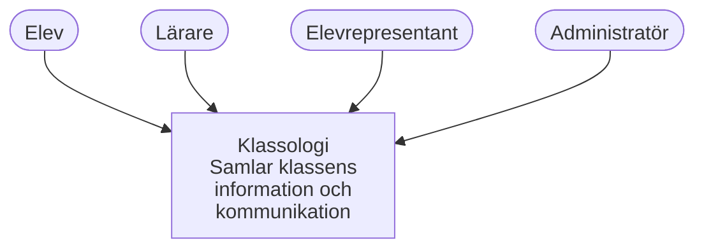
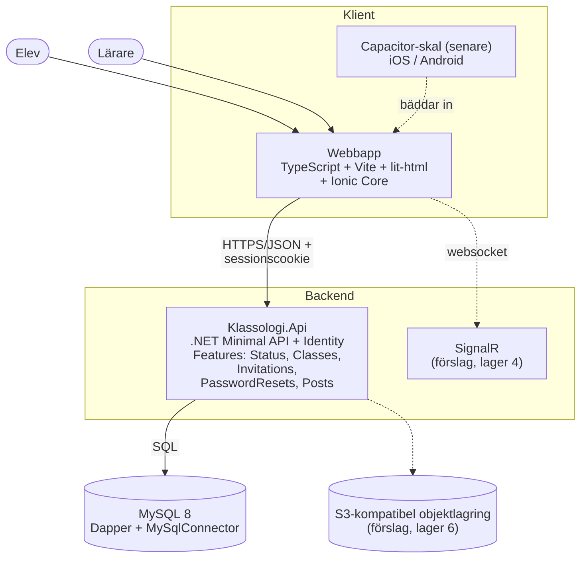
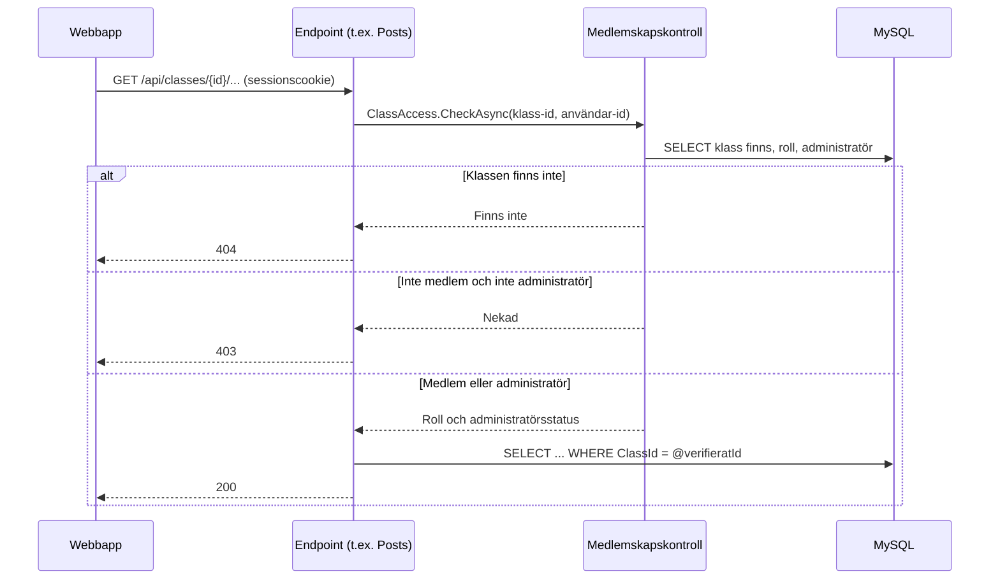

# Architecture

Systemets struktur i diagramform. Inloggningen sköts av API:t själv med ASP.NET Core Identity ([Q2](Questions.md#q2-användarnas-ålder-och-inloggning)), så det finns ingen extern identitetstjänst. Val och motiveringar finns i [Technology.md](Technology.md).

Diagrammen följer [C4-modellens](https://c4model.com) nivåer och skrivs i Mermaid, så att de versionshanteras och granskas tillsammans med specifikationerna. Sekvensdiagram används för flöden där ordningen spelar roll.

Delar markerade *förslag* är inte beslutade. Komponentnivån ritas först när koden finns.

## Kontext

Vem som använder systemet. I MVP:n beror systemet inte på några externa system.

Elev, lärare och elevrepresentant är roller per klass, och administratör är en egenskap hos användaren ([Q5](Questions.md#q5-roller-och-behörigheter)). Elevrepresentantens extra behörigheter är inte avgjorda ([Q13](Questions.md#q13-elevrepresentantens-behörigheter)). Externa parter (företag, lärosäten) är inte med, eftersom [Q6](Questions.md#q6-externa-parter) är öppen.

## Containrar

De delar som körs separat och hur de kommunicerar.

| Container | Ansvar | Status |
|-----------|--------|--------|
| Webbapp | Gränssnittet med Ionic-komponenter. Fungerar fullt ut på egen hand. | Beslutat |
| Capacitor-skal | Mobilappar och mobilfunktioner (push, notisåtgärder) | Beslutat, senare |
| Klassologi.Api | Affärsregler, behörighet, klassavgränsning och inloggning (Identity) | Beslutat |
| SignalR | Realtid för chatt och kanaler | Förslag |
| MySQL | All strukturerad data | Beslutat |
| Objektlagring | Filer och material | Förslag |

## Nyckelflöden

### Klassbunden förfrågan

Visar hur klassavgränsningen upprätthålls utan query-filter (se [Technology.md](Technology.md#dataåtkomst-dapper-utan-ef-core)). Klassens id används först efter att medlemskapet har verifierats, och data hämtas bara för det verifierade id:t.

En icke-medlem får 403 och en klass som inte finns ger 404 ([Q11](Questions.md#q11-svar-när-en-icke-medlem-försöker-nå-en-klass)). Kontrollen är implementerad i `Features/Classes/ClassAccess.cs`, och regler om roller inom klassen (t.ex. att bara lärare får ändra roller) avgörs med samma resultat.
